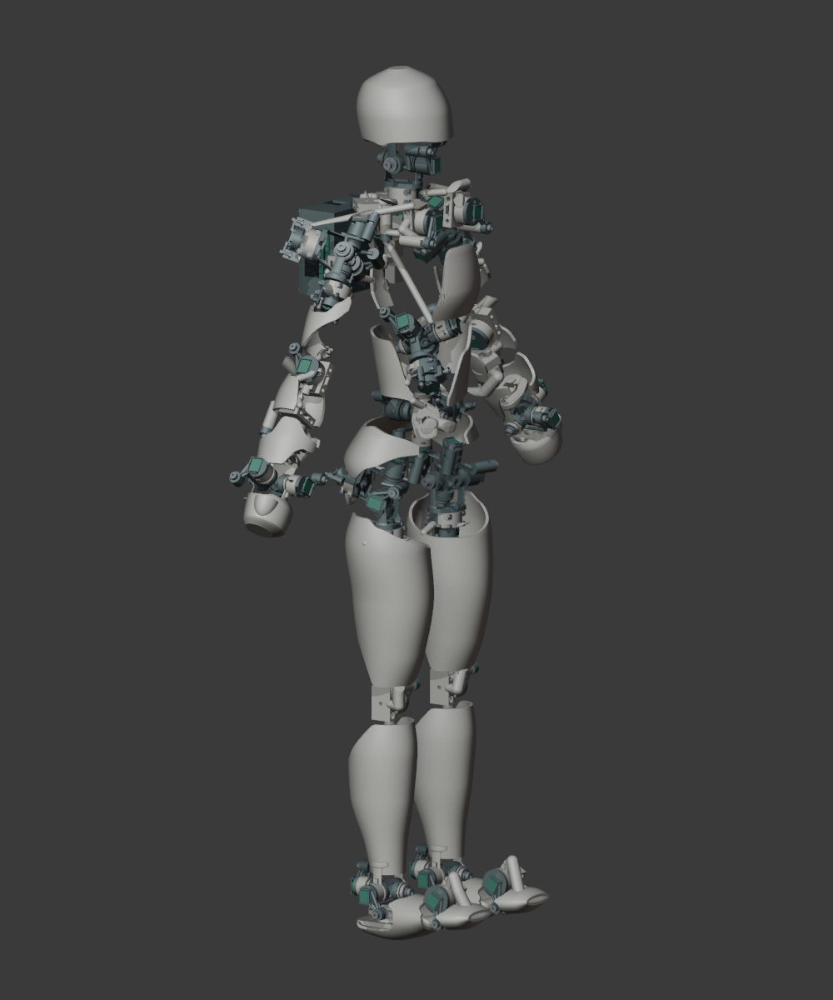

# O23D 人形承力骨架

O23D 是在 O22F7 关节与测量系统基础上重做的数字设计候选。外壁承担结构作用；关节、工具和维修开口保留。实际尺寸、检查结果和三维预览使用同一份装配几何。

## 当前结果

| 项目 | 本版结果 |
|---|---|
| A 站姿实体高度 | 706.26 mm |
| 主要承力结构件 | 24 件，24 件为单个封闭实体 |
| 原始机械轴 / 关节模块 | 46 / 23 |
| 实际髋中心距 | 82.581 mm，与 UE Quinn 等比例骨骼坐标一致 |
| 相对旧版每侧髋内移 | 22.4 mm |
| 上半身整体抬高 | 22 mm；四肢骨长与肩宽不变 |
| 日常姿态检查 | 408 个，必须处理的相邻碰撞 0 条 |
| 额外过渡姿态检查 | 114 个，相邻碰撞 0 条 |
| 非相邻接触 | 536 条提示，允许通过调整摆姿避开 |
| 背盒工具与板件取出 | 细杆工具方案 通过；板件取出 通过 |
| 右腕商业传感器板 | 通过所检角度下的实体装配检查 |
| 3MF 几何审查文件 | 32 件；逐项保存源顶点索引 |
| STL 焊接后拓扑未通过 | 16 件，具体件号见导出报告 |
| 制造状态 | 尚未切片验证、实物试装或强度放行 |

腰部的实际轴心比身体参考点高 8 mm，为居中的两套髋机构让位。前臂旋转模块沿各自轴线向肘侧移 8 mm，右侧座绕轴转 180°；这些前臂改动不改变身体参考点和骨长。原测量通道顺序、原始角限和身体旋转关系通过独立数值核对。

两侧锁骨前伸模块绕原轴换向 90°，胸部和锁骨连接件按新安装方向重建。此改动避开抬臂过程中的传感器板接触；原肩关节位置、肩宽及身体姿态映射保持不变。

## 使用与审查

- 打开 `preview/index.html` 查看实际可旋转模型；可切换坐姿、前伸、托举、浅蹲、迈步，以及单个结构件。
- [本轮外壁与髋位置说明](CONTINUOUS_WALLS.zh-CN.md)
- [UE 比例与实际髋中心对照](UE比例对照.csv)
- [结构件清单](结构件清单.csv) / [附件与右腕打印件](附件清单.csv)
- [与已购 O22F7 五金对照](五金变化表.csv)
- [日常动作逐零件检查](verification/daily_motion.json)
- [易接触区域的加密过渡检查](verification/edge_paths.json)
- [真实髋中心与跨模块装配检查](verification/hip_centers.json)
- [锁骨模块静态装配检查](verification/collar_static_packing.json)
- [新连接件与固定零件配合检查](verification/fixed_interfaces.json)
- [全部新结构件与 F7 固定配合总核对](verification/fixed_all_interfaces.json)
- [尺寸、网格与运动学检查](verification/geometry.json)
- [STL 与 3MF 导出检查](verification/export_formats.json)

## 外形与装配

头部保留简单头颅轮廓，手部为握拳。各骨段的径向外壁没有独立碎孔：避让口延伸至相应关节端部，剩余外壁为连续面。螺孔、传感器座和螺母装入口属于必要功能细节。胸肩和腰部仍有较大的机构开口，上臂、前臂的外壁也保留关节侧缺口；本版尚未形成完整包覆的人体外形，实际形状以三维预览为准。

背部保留 74 × 70 × 34.2 mm 控制盒及四颗 M3 × 8 固定螺钉。缩短安装座向前伸出的多余材料，保留螺母口袋和承压面。控制板拆出前需要打开后盖、卸下板件螺钉并断开线束。靠近 XIAO 排针的一颗板件螺钉需要所检直径 3 mm 的细杆工具；直径 6 mm 的失败结果仍保留。工具检查不含手柄和人手。

商业传感器板不做镜像制造，右腕通过刚体翻转安装。组装后需校准传感器零位和方向。

## 尚未完成的制造验证

本版完成的是记录中的离散实体检查，并未证明所有中间姿态和任意关节组合。真实线束、摩擦持姿、静载、疲劳、壁厚切片、支撑拆除与实物公差仍需验证。建模体积换算的 PLA 重量不能作为切片耗材或实测重量。

64 × 60 mm 控制电路板已布局，尚未布线，不能直接投板。3MF 是带候选摆放方向的几何文件，不含打印机、材料、支撑或切片参数。STL 的顶点量化问题按实际回读结果列出，不作为已可打印文件。

O22F7 原打印包没有修改。旧 O23C 与失败的中间试验保留在 `history/` 和带版本名的验证文件中；只有本页及 `DELIVERY.json` 所绑定的几何代表当前交付。

几何 SHA-256：`64d347b397c0eb90f084982b04a33fd9bcf3adab72a4eebca7e4de686451e7fc`。
