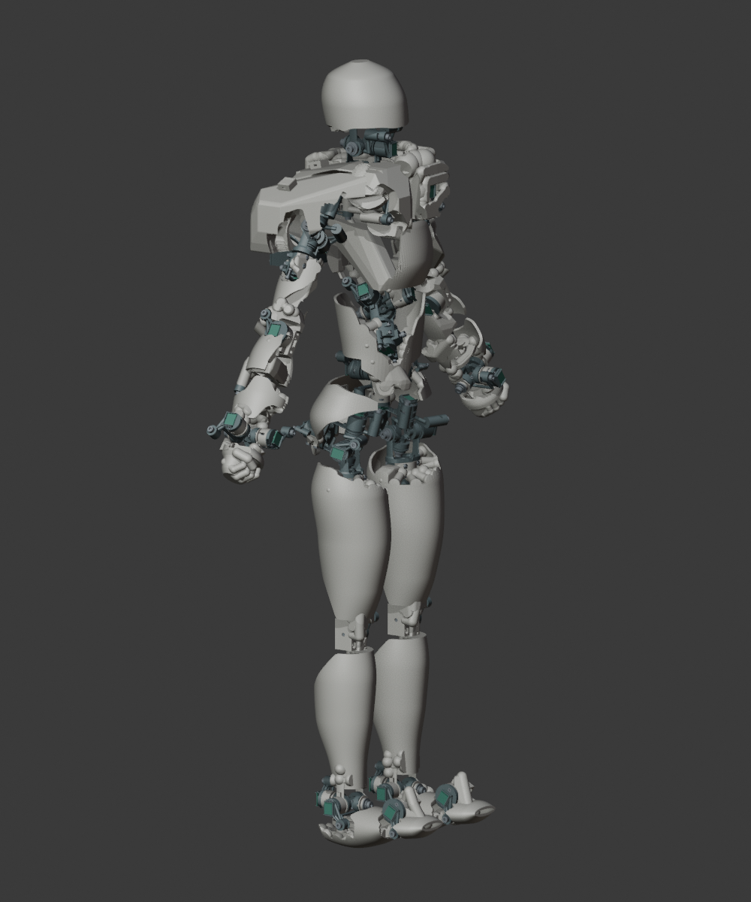

# O23E 人形承力骨架

O23E 在已接受的 D 版外形上，增加五指握拳、加强结构连接，并加入实际打印的内部布线固定座。高度 706.26 mm；身体运动学、实际髋中心与 UE 比例沿用 D 版。

| 项目 | 当前结果 |
|---|---|
| 身体结构件 | 24 件，全部为单个封闭实体 |
| 手部 | 左右各 5 根固定握拳手指 |
| 日常 / 加密过渡姿态 | 408 / 114，相邻穿透记录为 0 |
| 打印固定座 / 内部通道 | 32 / 7 |
| 传感器 / 机械轴 / 模块 | 46 / 46 / 23 |
| 3MF 审查件 | 32 件 |
| 制造状态 | 数字候选；实物强度、持姿、布线与切片未放行 |

- [本轮五指、连接与布线优化说明](FINGERS_STRUCTURE_HARNESS.zh-CN.md)
- [布线规格及试装顺序](harness/布线与试装说明.zh-CN.md)
- [全部连接截面筛查](连接截面筛查.csv)
- [结构件](结构件清单.csv)、[附件](附件清单.csv)、[五金变化](五金变化表.csv)、[UE 比例](UE比例对照.csv)
- [当前检查入口](verification/README.zh-CN.md)
- [D 版外壁与髋中心设计背景](history/O23D_before_fingers_strength_harness_20261020/CONTINUOUS_WALLS.zh-CN.md)

预览 `preview/index.html` 可切换姿态、选择零件及剖切，勾选“布线固定座与通道”查看真实预留位置。

当前打印几何的 PLA 实体等效为 1910.8 g，不含五金、电子和线材。新增质量需要实物持姿验证。控制板仍是未布线布局稿；STL 格式问题以当前导出报告为准，优先用 3MF 审查。

胸肩连接比 D 版明显加厚，是当前加强方案的外观与重量代价；人体参考点和四肢比例没有因此变化。

O22F7 原打印文件未改动。D 版保存在 `history/O23D_before_fingers_strength_harness_20261020/`。E 版候选与脚本位于 `design/reinforced_candidate/` 及设计根目录 `scripts/`，不能用旧 D 版构建命令覆盖当前结果。

几何 SHA-256：`e9bd47cc6a64a2e92148e237acaccf98df93c1a4fdc1f8524e6df6613fbfaa8d`。
