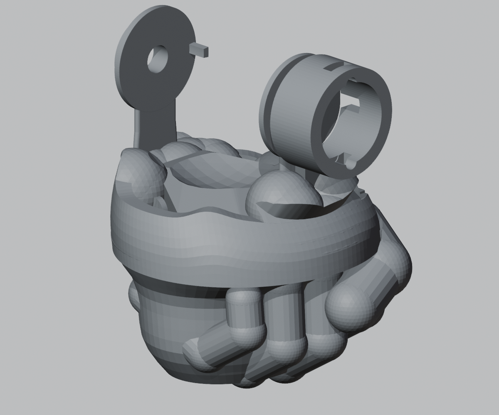

# O23E 五指握拳、连接加强与内部布线

本版在已接受的 O23D 外形上优化结构，实际高度 706.26 mm。身体参考点、实际双髋中心、关节轴与角限均沿用已校核的 D 版。本轮没有再改变 D 版的五金配置；新增耗材是软导线和扎带。

按仓库 O22F7 装配修订版“含备件”采购清单核算，整个 O23 方案仍需补 M1.6 螺母 4 个、M1.6 × 6 螺钉 4 个、M2 × 6 自攻螺钉 2 个。完整数量见 [五金变化表](五金变化表.csv)，请按实际已购数量核对。

## 双手

左右手各有四根弯曲手指和一根横扣的拇指，左右拇指方向相反。手指与掌部连成一个打印实体，不增加活动手指或测量通道。掌部采用空腔，腕部精密安装面保留。

## 全部连接与相邻干涉

24 个身体结构件均为单个封闭实体。原细连接处增加宽连接台、圆角过渡和多条内筋；大腿近髋、肘部及胸肩连接分别进行了截面筛查。加强后按最终实际零件重新修整抬臂避让，避免新材料侵入相邻机构。

胸肩连接的加厚在外观上较明显，尤其是锁骨区域。这里的“原外壁保留”指原人体外壁未被新增孔洞破坏，不表示加强后的胸肩外包络与 D 版完全相同。请以当前整机和单件视图评审外观。

以下数值使用相同的 1 mm 体素最小割方法，表示几何连接的截面筛查结果：

| 连接位置 | O23D / mm² | O23E / mm² |
|---|---:|---:|
| 左大腿近髋连接 | 6.93 | 297.91 |
| 右大腿近髋连接 | 9.24 | 277.71 |
| 右肘原薄弱连接 | 3.46 | 107.96 |

完整结果见 [全部连接截面表](连接截面筛查.csv)。总计 49 处保留安装面到外壁或另一安装面的路径均连通。体素结果不能直接换算成许用载荷；打印层方向、层间结合、螺钉预紧和材料强度尚需实测。

- 408 个日常姿态与 114 个加密过渡姿态：必须处理的相邻穿透记录均为 0，报告容差 0.05 mm³。
- 逐一核对同一刚体内的新结构与五金、磁铁座、PCB 的装配。保留有明确体积上限的自攻螺钉咬合；它们不作为意外穿模。
- 背盒细杆工具方案和 22 步控制板取出检查通过。靠近 XIAO 的螺钉仍需要直径 3 mm 的工具杆，粗杆失败结果保留。
- 非相邻接触保留为提示。离散检查不代表所有任意组合与连续路径都已经验证，也未证明全程 2 mm 间隙。

## 内部线材固定

实际打印几何包含 **32 个扎带固定座**，其中 30 个在身体结构件上，2 个在背盒侧缘入口处。覆盖腕部线路沿前臂、肘、上臂、锁骨、胸部到背盒的路径，以及头部和双腿回路。另有 **7 条连续内部通道**连接长骨段上的两个固定座。身体固定座与内壁连成一体，扎带从座下的贯通槽穿过，不在人体外壁上增加碎孔。

全部固定座的扎带孔、承压顶面及记录的线束包络已按最终保存的模型复查；线束固定空间经过 522 个姿态检查。关节两侧分开固定，中间留松弛弧形线圈，不能用一根绷紧的线跨越关节。柔性线圈的真实形状、挤压与寿命仍需试装。

预览中的“布线固定座与通道”显示真实固定点与内部通道。它不绘制未经验证的柔性线形。

详见 [布线与试装说明](harness/布线与试装说明.zh-CN.md) 和 [46 路初步裁线表](harness/preliminary_cut_list.csv)。

## 重量与制造状态

按建模实体体积及统一 PLA 密度换算，全部打印几何为 **1910.8 g**，O23D 对照为 999.6 g，增加 911.3 g。这不含五金、PCB 和线材，也不是切片耗材预测。加强件增加的质量会提高摩擦持姿负担，应在首件试装时检查肩、髋和腰的持姿，不能由几何通过直接认定已满足承载。

输出 32 个保留索引的 3MF 审查件。STL 回读拓扑未通过的件数为 25，见导出报告；优先使用 3MF 进行受控切片审查。尚未完成切片、实物装配、静载与疲劳验证。

背部 64 × 60 mm 控制板目前仍为布局稿，未布线，不能直接投板。较长传感器线的通信信号完整性也需样线测试。现阶段为数字工程候选，非制造放行包。

几何 SHA-256：`e9bd47cc6a64a2e92148e237acaccf98df93c1a4fdc1f8524e6df6613fbfaa8d`。
