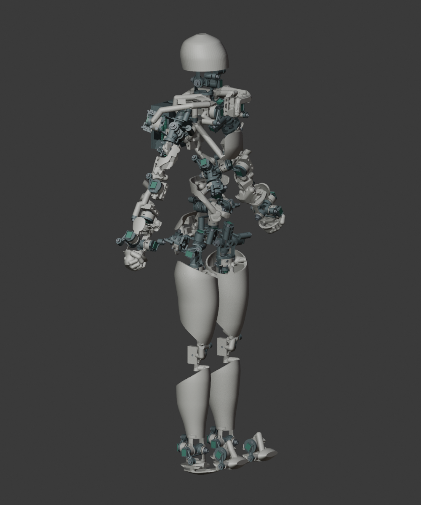

# O23F 对称外壁与少量连接

本版按最新要求重建外壁，并删去 O23E 的密集支撑。当前实际高度 **706.26 mm**，沿用原有 UE 人体参考点、双髋中心、骨段长度和关节映射。本轮沿用 O23E 的五金配置，不增加或更换五金件。相对 O22F7 原购清单的既有差异仍见 [五金变化表](五金变化表.csv)。

## 外形

- 大腿和小腿保留人体曲线；关节开口使用一条平顺的大曲线。
- 胸部改为完整圆角护片；腰和骨盆改为对称的后侧护片，前部运动空间保持开放。
- 肩部取消覆盖效率很低的大块镂空壳，保留紧凑的安装端与少量承力连接。
- 手臂用小型圆角护片。双手保留四指弯曲、拇指前扣的握拳形态，并统一两侧拳壳轮廓。
- 人体外壁按左右镜像检查；内部安装孔、传感板接口和走线座仍适配实际机构。它们不是整件几何完全镜像的承诺。

外壁由完整筒壁或单块圆角曲面生成，不再按障碍物逐个切出小豁口。最终模型中这些设计外壁均完整保留；关节大开口、检修空间和精密安装孔继续保留。

## 连接数量与结构

以**同一个外壁结构件与相邻单个关节模块或完整背盒**为一组，最多 **3 根**连接杆，满足三根上限。直接连接两个安装端的杆会同时计入两端。详细记录见 [连接杆数量表](连接杆数量表.csv) 和 [几何计数报告](verification/physical_rod_count.json)。

采用少量明确的杆体和局部加宽安装台，替代 O23E 的多条细筋。布线固定座直接融合到内壁或杆体，没有另加一套支杆。薄弱部位按实际截面调整连接落点和承力路径；大腿近髋、上臂、前臂与背盒均单独检查。

51 处安装面到外壁或其他安装面的几何路径连通；完整数值见 [连接截面筛查](连接截面筛查.csv)。这是 1 mm 体素最小割筛查，不是有限元分析或承载认证。打印层方向、材料、螺钉预紧与持姿仍需首件验证。

## 日常动作与布线

- 408 个日常姿态及 114 个加密过渡姿态：相邻部位必须处理的穿透记录为零，体积报告容差 0.05 mm³。
- 非相邻部位接触按已确定的规则作为提示；极限姿态不作为本次硬性条件。
- 24 个结构件为单个闭合实体；运动轴、原始角限、传感器配置和五金接口保持原方案。
- 实际打印件有 **33 个布线固定座**、**8 条内部固定通道**。46 路五芯线束已按新固定点重算长度和容量。
- 仍按 AWG30 细多股软线、含绝缘外径不超过 0.7 mm 设计。关节间保留松弛线圈，不能拉紧。柔性线实际挤压和疲劳需试装验证。

详见 [布线与试装说明](harness/布线与试装说明.zh-CN.md) 和 [初步裁线表](harness/preliminary_cut_list.csv)。

## 文件与制造状态

按全部打印几何的建模实体体积及 PLA 密度换算，本版为 **1060.8 g**，O23E 对照为 **1910.8 g**，减少 **850.0 g**。这不含五金、电子件和线材，也不是切片耗材预测。

提供 32 个索引网格 3MF 评审件。STL 回读拓扑未通过的件数为 23，详见导出报告；优先使用 3MF 做切片审查。本版仍是数字工程评审稿，尚未完成切片、实物装配、静载与疲劳验证。背部控制板仍为未布线的布局稿。

O23E 原模型和报告保存在 [历史快照](history/O23E_before_clean_symmetric_walls_20261021/DESIGN.zh-CN.md)。

几何 SHA-256：`47c788b92b3b43d5d2cc2d55be1483198d99cd313e275613233daa0848e6a752`。
