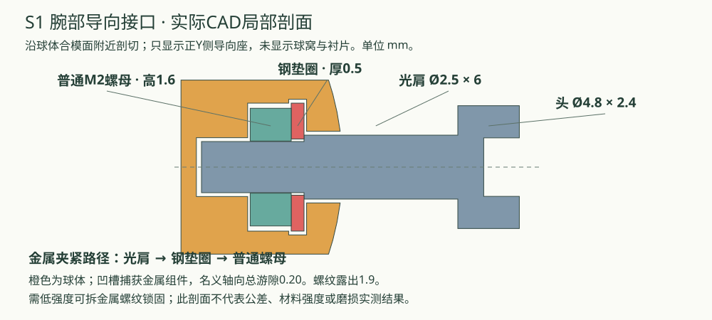

# O24C-T1-S1：按可购肩螺钉修改腕部

2026-10-22。**按用户已找到的D2.5×6/M2肩螺钉修改六件腕部打印件，取消原D3/M2规格的采购要求。** 这是新的配套接口，不能把小肩螺钉直接装入旧T1打印件。尺寸单位为mm。

## 采购结论与纠正

原 [Accu SSH-M2-6-3-A4-R360](https://www.accu.co.uk/metric-socket-shoulder-screws/637045-SSH-M2-6-3-A4-R360) 确实有D3肩、肩长6、M2螺纹长4、头D5×2的目录参数，但厂家明确标为 **Not Standardised**。先前把它当作容易采购的通用规格不妥，应按实际可以买到的商品修改设计。

查到的嘉立创 [标准型自由指定系列](https://www.jlcfa.com/serial/2174571191761.html) 轴径从4起、肩长从10起；[经济型系列](https://www.jlcfa.com/serial/1504714523884.html?codeModel=LC-TBH83&series=1) 虽有肩长6，轴径仍从4起。未核实到与原D3/M2全部尺寸匹配的国内型号。这只是已查系列，不代表全站所有商品或库存保证。淘宝登录流程未继续，采用用户已提供的商品图尺寸。

| 采购项目 | 参数 | 一套净用量 |
|---|---|---:|
| 腕部导向轴肩螺钉 | **光杆Ø2.5×长6；M2×0.4螺纹长4；头Ø4.8×高2.4；内六角2；304不锈钢** | **2颗** |
| M2平垫圈 | **外径5×内径2.2×厚0.5**；导向座新增2片，其余6片用于原位置 | **8片** |
| 导向普通M2螺母 | AF4×高1.6，螺距0.4；可复用O22同尺寸件 | 2颗，不变 |
| R站M6大垫圈 | 18×6.4×厚1.5，两片同厚；原1.6也可 | 2片，不变 |

肩螺钉尺寸来自用户“肩轴螺钉.png”的天卓五金标注，头下总长为6+4=10，尚未测量到货件。D3/M2.5不适用于S1。整套五金仍为23项规格，净数量由106变108；对比O22新增17项79件、可复用6项29件。不含备件和锁固耗材。

## 接口改动

| 部位 | 原T1 | S1 |
|---|---|---|
| 球窝及衬片槽宽 | 3.44，配D3 | **2.94，配D2.5** |
| 名义横向总间隙 | 0.44 | **0.44**，不是实测角度回差 |
| 肩部支承 | D3肩直接靠塑料孔边 | **D2.5肩→0.5钢垫圈→1.6普通金属螺母** |
| 球内结构 | 小塑料环承受肩部拧紧力 | 凹槽捕获直接贴合的金属堆叠 |
| 导向螺纹穿出量 | 1.0 | **1.9**，超过本套件两牙0.8的检查门槛 |
| 导向头最外位置，距球心 | 17.5 | 17.9，增加0.4已纳入干涉检查 |

原方案直接换D2.5会把槽间隙增到0.94，塑料孔边承压宽度仅剩0.10。本版同时修改槽和支承：肩部压在钢垫圈上，垫圈直接由普通螺母背托。拧紧夹力在三件金属间闭合；球内凹槽仍承受导向载荷并防脱，不能理解成塑料不再受力。

捕获组件预留名义0.20总轴向游隙，不用紧固肩螺钉挤压球体。垫圈穴外侧最薄名义球壁约1.08，需要检查打印质量和磨损。不要拧紧以消除该游隙。球径D22、球心、腕部运动轴和杆长保持原值。本次是台架接口适配，不是整条手臂制造定版。

## 重印范围

**必须配套更新W01、W02、W04、W05、W06、W07，共6件**：球半体、衬片、球窝各两件。对应P0_fit_1和P3_wrist_1；整盘含未变零件，已有旧件时可只打印六件新版STL。

备选内径衬片W04/W05的R11.15、R11.25共四个文件也已改为S1槽宽。其余20件基础件、8个轴承孔备选件形状不变；W03占位块、W08固定桥、W09加载杆可继续用。

本目录STL、3MF、预览、Blender、BOM和压缩包统一更新为S1，目录仍叫revO24C_T1。旧包留在仓库 `output/o24ct1-stock-adaptation/before/O24C_T1_before_D2p5.zip`，用于追溯，勿混装。

## 到货试配与锁固

1. 先在球外干装螺钉、0.5垫圈和普通螺母。垫圈必须平贴肩部台阶，不能骑在退刀圆角上，也不能滑过光肩。商品图没有局部公差，几何计算不能代替此项检查。
2. 拆下螺钉，从球体合模面装入垫圈及螺母，再闭合球体；先装好衬片并包合球窝，最后从外侧穿入肩螺钉。头部不能穿过槽。
3. 保留AF4×1.6普通螺母和低强度可拆金属螺纹锁固。**导向处禁止换3mm高尼龙螺母**：4mm螺纹减0.5垫圈、3mm螺母仅余0.5，低于本设计两牙0.8要求。按锁固产品说明确认不锈钢、附近PLA及固化条件；只处理啮合金属牙，不让胶进入球面、凹槽和导向槽。
4. 干装通过后锁固，充分固化再做持姿与循环测试。持姿仍由M3球窝预紧螺钉调整。记录导向组件松动、槽边磨损、垫圈变形及裂纹。

## 之前确认的垫圈仍适用

新增导向座两片M2垫圈必须0.5厚。其他六片允许0.5或原0.3；用0.5时，衬片M2×8穿出约1.9，加载杆M2×20约4.0，无需换螺钉。三维模型中这六片仍保留0.3基准。

R站两片18×6.4大垫圈允许1.5或1.6，两片同厚。用1.5时转子沿原轴线向固定压板移动0.1、浮动压板多合拢0.2，M3×30穿出约2.0，轴承端面名义退让仍0.4。从松装消隙后再调预紧，不在已预紧状态强行压入0.2。三维模型保留1.6基准。以上均以表中内外径为条件。

## 验证范围

本版重新检查981个名义姿态、静态装配、螺钉长度、插入路径和每侧0.20球窝预紧避让；另核对0.5/1.5垫圈配置的770个姿态。导向专项检查覆盖金属贴合、球内放入垫圈/螺母、后装肩螺钉、2mm工具空间和捕获防脱。打印工程经离线切片检查。

报告：[导向接口](verification/stock_guide_checks.json)、[活动干涉](verification/collisions.json)、[垫圈替代](verification/hardware_alternatives.json)、[切片](verification/slicing.json)。**尚未打印或实测持姿、松动与耐磨。** 名义几何通过不能保证未知商家公差、PLA强度、锁固效果或寿命。先按P0试配，再打印其余件。

[采购对照](PURCHASE_DELTA_O22.html) · [装配手册](ASSEMBLY.html) · [测试计划](TEST_PLAN.html) · [打印入口](START_HERE.html)
