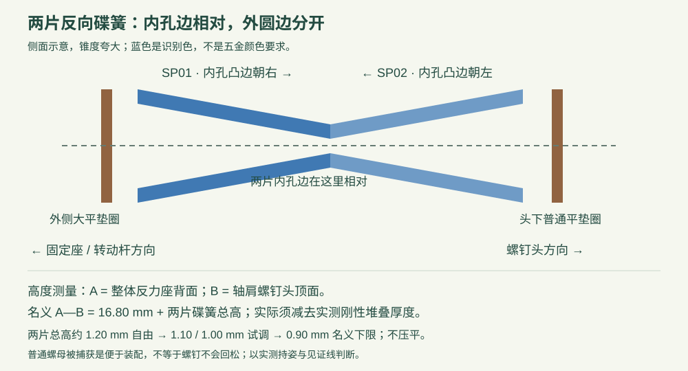

# O24C-T2-H · 碟簧预紧样件

这是替代旧 H 机械方案的新测试件，不能混装旧 H01～H08。用户已报告旧 H 持姿明显不足；不能再把旧 H 当作“实物验证通过”。本版只验证 H，不代表 R、W 或完整人偶已经验证。

## 需要重新打印什么

| 编号 | 名称 | 数量 | 要点 |
|---|---|---:|---|
| H2-01 | 整体反力座 | 1 | 连续反力壁；无旧 H04 的悬臂压板 |
| H2-02 | 100 mm 整体转动杆 | 1 | 3 mm 厚、Φ4.25 轴孔；没有轴承 |
| H2-03 | 普通螺母止转后盖 | 1 | 六角槽固定螺母，正面只需一把内六角调节 |
| H2-C01 | 试配片，可先单独打印 | 1 | 三个孔从左到右4.15 / 4.25 / 4.35，六角槽AF5.8 |

完整样件打印工程是 [P1_H2_sample.3mf](printing/P1_H2_sample.3mf)，内含前三件。试配片单独在 [P0_H2_fit.3mf](printing/P0_H2_fit.3mf)。不要把试配片装进关节。

A1 mini、0.4 mm喷嘴、PLA、0.12 mm层高、5圈墙、100%填充；使用工程中的方向与支撑设置。H2-01小孔正面朝下，H2-03平背面朝下，H2-02平放。先清理孔、螺母槽与摩擦面上的支撑和象脚，不把3 mm圆盘磨薄来强行适配。4 mm光杆应能滑过转动孔；孔紧或槽不能装入时先停止，记录实际尺寸，不靠大扭矩硬拉。

## 五金清单与复用

| 五金 | 净数量 | 来源 / 参数 |
|---|---:|---|
| O22轴肩螺钉 | 1 | 光杆Φ4×8，M3×0.5螺纹长6，头Φ7×3，内六角3 mm；用户确认已有 |
| A8碟簧 | 2 | 8×4.2×0.4，自由高约0.6 mm；用户确认已有 |
| M4大平垫圈 | 2 | 钢制12×4.3×1.0，可拆用旧H |
| M4普通平垫圈 | 1 | 钢制9×4.3×0.8，可拆用旧H后桥 |
| M3大平垫圈 | 1 | 钢制9×3.2×0.8，O22规格；不能用7×3.2×0.5替代 |
| 普通M3六角螺母 | 3 | M3×0.5，AF5.5，高2.4，无尼龙圈；可拆用旧H转子 |
| M3×12内六角圆柱头螺钉 | 2 | 2.5 mm内六角；可拆用旧H转子 |
| M3小平垫圈 | 2 | 钢制7×3.2×0.5；可拆用旧H |

本样件不使用684ZZ轴承、D4×45光轴、旧H的M3×30预紧螺钉或尼龙锁紧螺母。不要为了继续利用它们而加回新摩擦链。旧件保存好，方便对照。

## 压紧力怎样传递

轴肩螺钉头 → M4普通垫 → 两片反向碟簧 → 外侧大垫 → 转动杆 → 内侧大垫 → 整体反力座 → M3反力垫 → 内藏普通M3螺母 → 螺钉。

后盖只负责定位和阻止螺母转动，不用后盖的薄边承担主要预紧。它的凸台与反力垫之间名义留0.15 mm，螺母直接顶反力垫。反力座内部承压壁名义厚2.8 mm；其强度和松弛仍需实测。

碟簧负责在小位移内提供弹性预紧；摩擦来自受压接触面。增加碟簧不等于自动增大摩擦系数，也不保证长期不掉力矩。两片反向串联用于增加可用位移，不是把单片弹力简单翻倍。

## 逐步装配

每一步的实际零件和运动方向也可在 [逐步装配页](viewer/index.html) 查看。先夹稳或托稳基座，换面时用手托住尚未固定的垫圈。不要把动画里悬空停住的零件当成实物能自动固定。

### 1. 确认新件与基座方向

本步零件：H2-01。

只使用 H2-01 / H2-02 / H2-03。小轴孔的一面为正面，大圆腔为背面。本样件所有 M3 螺母都是普通螺母，无尼龙圈。

工具：手放 / 镊子仅用于放置。

### 2. 从背面放入反力垫

本步零件：M03。

用 O22 的 M3 大垫圈 9×3.2×0.8，光滑面朝孔内反力壁。它应平放在大圆腔最深处；不能换成 T1 的 7×3.2×0.5 小垫圈。

工具：手放 / 镊子仅用于放置。

### 3. 单独拿出止转后盖

本步零件：H2-03。

先在基座旁装好后盖上的螺母。带圆形凸台和六角槽的一面朝你；这时还不合上基座。

工具：手放 / 镊子仅用于放置。

### 4. 把调节螺母放入后盖

本步零件：M02。

普通 M3×0.5、对边5.5、高2.4。平整承压面朝凸台开口，之后贴反力垫。螺母应进入六角槽，不能自由转一圈。不要用带塑料圈的锁紧螺母。

工具：手放 / 镊子仅用于放置。

### 5. 带螺母的后盖合到基座

本步零件：H2-03 / M02。

托住螺母，把圆形凸台从背面直送入大圆腔。后盖平面贴住基座背面；不能用螺钉硬拉未入位的后盖。

工具：手放 / 镊子仅用于放置。

### 6. 放入第 1 颗后盖固定螺母

本步零件：C_N1。

普通 M3×0.5，AF5.5，高2.4；平整承压面朝六角槽底。装进基座正面的六角槽，应沉入表面，不能突出。

工具：手放 / 镊子仅用于放置。

### 7. 放入第 2 颗后盖固定螺母

本步零件：C_N2。

普通 M3×0.5，AF5.5，高2.4；平整承压面朝六角槽底。装进基座正面的六角槽，应沉入表面，不能突出。

工具：手放 / 镊子仅用于放置。

### 8. 后盖第 1 处放小垫圈

本步零件：C_W1。

M3 平垫圈 7×3.2×0.5，光滑面贴后盖。可从旧 H 拆用，先检查是否变形。

工具：手放 / 镊子仅用于放置。

### 9. 旋入后盖第 1 颗固定螺钉

本步零件：C_S1。

M3×12 内六角圆柱头螺钉，从背面旋入已被六角槽固定的普通螺母。先对牙，再轻紧；两颗交替贴合即可，不用把 PLA 压变形。

工具：2.5 mm 内六角扳手。

### 10. 后盖第 2 处放小垫圈

本步零件：C_W2。

M3 平垫圈 7×3.2×0.5，光滑面贴后盖。可从旧 H 拆用，先检查是否变形。

工具：手放 / 镊子仅用于放置。

### 11. 旋入后盖第 2 颗固定螺钉

本步零件：C_S2。

M3×12 内六角圆柱头螺钉，从背面旋入已被六角槽固定的普通螺母。先对牙，再轻紧；两颗交替贴合即可，不用把 PLA 压变形。

工具：2.5 mm 内六角扳手。

### 12. 检查后盖与反力座

后盖不能晃动，中央螺母不能跟转，反力垫不能倾斜。后盖只负责定位螺母；主要压力经螺母→反力垫→整体反力座传递。

工具：目视 / 轻推检查。

### 13. 放内侧大垫圈

本步零件：F01。

M4 大垫圈 12×4.3×1.0，光滑面朝外，即朝接下来要装的转动杆。先使正面朝上，支撑或夹稳基座，再叠装。

工具：手放 / 镊子仅用于放置。

### 14. 放整体转动杆

本步零件：H2-02。

圆盘孔对准轴心。圆盘厚3.00 mm，两面去毛刺且平整；转动杆要能在金属轴肩上自由转动，不能先靠孔壁过盈产生阻力。

工具：手放 / 镊子仅用于放置。

### 15. 放外侧大垫圈

本步零件：F02。

第二片 12×4.3×1.0，光滑面朝内，贴转动杆。现在两片大垫圈的光滑面相向，夹住转动杆圆盘。

工具：手放 / 镊子仅用于放置。

### 16. 放第一片 A8 碟簧

本步零件：SP01。

8×4.2×0.4，自由高约0.6。内孔附近凸起的边朝外（朝未来的螺钉头）；外圆边靠外侧大垫圈。蓝色只为识别碟簧，实物不需涂色。

工具：手放 / 镊子仅用于放置。

### 17. 第二片碟簧翻面安装

本步零件：SP02。

第二片要翻面：内孔凸起边朝内（朝固定座）。两片在内孔边相对接触，外圆边分开。不能同向套叠；不要用开口弹簧垫圈替代。

工具：手放 / 镊子仅用于放置。

### 18. 放头下普通 M4 垫圈

本步零件：M04。

M4 普通平垫圈 9×4.3×0.8，放在碟簧外侧。这一片两面均贴金属，没有强制正反；两面均须去毛刺，能自由套过 Φ4 光杆。

工具：手放 / 镊子仅用于放置。

### 19. 旋入 O22 轴肩螺钉

本步零件：AX01。

光杆Φ4×8，M3×0.5螺纹长6，头Φ7×3。先用手轻旋对牙，再用3 mm内六角。它是旋入普通螺母，不是直接压过去；动画中的螺纹为简化外形。

工具：3 mm 内六角扳手。

### 20. 从轻接触开始调整

转动杆仍要能动。消除松旷后，每次只微调约1/24圈并复测。优先试两片总高1.10、1.00 mm；名义下限0.90 mm。不要拧到碟簧压平或靠孔底顶死来获得阻力。详见手册中的实测高度方法。

工具：3 mm 内六角 / 卡尺 / 记号笔。

### 21. 检查活动范围

先低预紧，再以目标预紧检查：肩部工况−45°～165°，肘部工况0°～145°。下方角度滑块只演示几何，不代表持姿已通过。

工具：夹具 / 量角器。

### 22. 先测肘，再测肩

先筛选0.040 N·m，再尝试0.130 N·m。在100 mm力臂上分别是0.40 N和1.30 N。保持10分钟并记录漂移；标记轴肩螺钉头相对基座的位置。螺母止转不等于螺钉不会回松。

工具：测力计或称量砝码 / 固定视角照片。

## 预紧高度：先实测，不把圈数当力

本版模型用两片总高1.00 mm作展示；不是要求装到这个数值才算正确。若单片自由高0.60、材料厚0.40，则两片反向的自由总高约1.20，压平总高0.80。试验先从1.10、1.00逐步比较；0.90对应名义75%压缩。没有本批碟簧的力—位移数据，不继续压到0.80或反向翻碟。

量法：以H2-01的平整背面为A面（避开后盖及其螺钉），轴肩螺钉头最外端为B面。用卡尺保持与轴平行量A—B。名义总高D = 16.80 + 两片碟簧总高；例如D=17.80对应1.00 mm。实际要减去实测的“基座厚度 + 两片大垫厚度 + 转动圆盘厚度 + 头下普通垫厚度 + 螺钉头高”，不能直接假定它们恰好合计16.80。A面在后盖外侧露出，量爪不能搭在后盖或固定螺钉头上。

如果量爪无法稳定贴住这两个面，不用一个不可靠的小数继续加压。先记录轻接触位置、小幅调整量和实际持姿；达到合理压缩范围仍轻拨即动，本版就应判为未通过，不以继续拧紧掩盖。

普通螺母被槽固定后，调节过程只需正面一把内六角。它解决装配时的止转，不构成对轴肩螺钉的独立防松锁。做双向循环时检查螺钉头相对基座的记号；回松则本版锁固未通过。首次对比不加胶、不润滑摩擦面，便于分辨压紧不足、磨损和螺钉回转。

## 与 O22 的关系和验证边界

轴肩、垫圈、两片碟簧和普通螺母的层次依据仓库O22装配说明G1；螺纹长6 mm及反力座深度参考O12现货样件。此前O22沿用的实物经验是选择这一结构的理由，不是新H已经通过的证据。

数字检查包括4个簧片高度下844个活动姿态、装入路径、力链接触、轴肩底部余量、普通螺母止转、直杆工具空间和离线切片。不包括实际接触压力、材料强度、碟簧弹力或持姿寿命。尺寸检查通过后仍按 [测试计划](TEST_PLAN.html) 记录实测结果。

参考：[SPIROL碟簧设计指南](https://www.spirol.com/assets/files/dsc-disc-spring-design-guide-us.pdf)；[SPIROL压缩范围说明](https://my.spirol.com/resources/white-papers/how-deflection-range-affects-the-performance-of-disc-springs/)。这些资料支持一般原理，不代表用户现有A8碟簧具有其中某个型号的力值。
